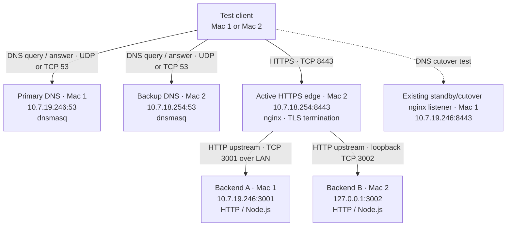

# Private Network Service Platform

**Computer Networks Course Project · Phase 1: Build and Observe · Phase 2: Harden and Recover**

A locally hosted networking project that demonstrates private DNS, HTTPS/TLS termination, reverse proxying, round-robin load balancing, HTTP cache validation, DNS resilience, backend isolation, failover, and packet-level troubleshooting using two macOS laptops.

> **Project principle:** The application is deliberately simple; the network services and the path taken by each request are the focus.

---

## Contents

- [Project overview](#project-overview)
- [Team and machine roles](#team-and-machine-roles)
- [Network topology](#network-topology)
- [Addressing and service ports](#addressing-and-service-ports)
- [Technology stack](#technology-stack)
- [Repository layout](#repository-layout)
- [Prerequisites](#prerequisites)
- [Configuration and setup](#configuration-and-setup)
- [API endpoints](#api-endpoints)
- [Phase 1 results](#phase-1-results)
- [Phase 2 results](#phase-2-results)
- [Wireshark evidence](#wireshark-evidence)
- [Troubleshooting](#troubleshooting)
- [Security and cleanup](#security-and-cleanup)
- [Team](#team)

---

## Project overview

The project builds a private service environment on a shared Wi-Fi/LAN. A client resolves a private `.test` hostname through one of the team's DNS resolvers, opens an HTTPS connection to the edge nginx server, and receives a response from one of two HTTP backends.

The private DNS namespace is `team1.test`:

- `app.team1.test` — application entry point
- `api.team1.test` — API entry point

The normal service entry point is `https://app.team1.test:8443` (or `https://api.team1.test:8443`). Nginx on Mac 2 terminates TLS and forwards requests to Backend A or Backend B.

The deployment is local. It does not depend on cloud hosting or a managed cloud DNS/load-balancing service.

### Main capabilities

- Primary and backup private DNS using `dnsmasq`.
- TLS termination and reverse proxying using nginx.
- Two identifiable HTTP/JSON backend instances.
- Round-robin upstream selection, visible through `X-Backend`.
- HTTP caching and conditional validation using `Cache-Control` and `ETag`.
- DNS backup-answer testing and a controlled 30-second TTL/cache experiment.
- Backend-port restrictions using macOS PF rules.
- Backend outage/recovery testing and DNS-based edge cutover.
- Protocol inspection using Wireshark.

---

## Team and machine roles

The course reference architecture describes four principal roles: DNS, edge/reverse proxy, Backend A, and Backend B. Because the team used two physical laptops, those roles were combined as follows.

| Machine | Team member | IPv4 address observed during testing | Main services |
|---|---|---:|---|
| Mac 1 | Shivansh Tiwari | `10.7.19.246` | Primary DNS, Backend A, existing nginx listener used as the standby/cutover edge, PF policy, test client |
| Mac 2 | Navprabhat Singh | `10.7.18.254` | Backup DNS, active nginx HTTPS edge/load balancer, Backend B, PF policy, test client |

Both Macs were observed on Wi-Fi interface `en0`, with subnet mask `255.255.224.0` (`/19`) and default gateway `10.7.0.1`. The corresponding subnet is `10.7.0.0/19`.

**Addressing note:** These IPv4 addresses were assigned through DHCP during the recorded tests. Check the current addresses before using the example configurations. If either address changes, update DNS records, nginx upstreams, PF peer rules, and client resolver settings.

Check the current network details on either Mac:

```bash
networksetup -getinfo "Wi-Fi"
ipconfig getifaddr en0
route -n get default | grep gateway
```

---

## Network topology



The DNS lookup and HTTPS request are separate stages. DNS returns the selected edge address; the client then establishes TCP and TLS to that address. Nginx selects the backend, so the client does not need to know the backend addresses.

Mac 1's port-8443 listener was already running during the controlled edge-migration test. Its presence was confirmed and it successfully returned a Backend A response after the application A record was changed to Mac 1. The old-cache/new-edge overlap was not separately captured.

---

## Addressing and service ports

| Port | Transport | Host | Service | Purpose / scope |
|---:|---|---|---|---|
| `53` | UDP/TCP | Mac 1 (`10.7.19.246`) | Primary `dnsmasq` | Primary private DNS resolver |
| `53` | UDP/TCP | Mac 2 (`10.7.18.254`) | Backup `dnsmasq` | Backup private DNS resolver |
| `8443` | TCP/TLS | Mac 2 (`10.7.18.254`) | Active nginx | Client-facing HTTPS edge and load balancer |
| `8443` | TCP/TLS | Mac 1 (`10.7.19.246`) | Existing nginx listener | Target used in controlled DNS edge-migration test |
| `3001` | TCP/HTTP | Mac 1 (`10.7.19.246`) | Backend A | Remote HTTP upstream reached over the LAN |
| `3002` | TCP/HTTP | Mac 2 (`127.0.0.1`) | Backend B | Nginx reaches this backend through loopback; PF restricts inbound Wi-Fi access |
| `5300` | UDP/TCP | Mac 1 (`127.0.0.1`) | Temporary caching resolver | Isolated TTL/cache experiment; forwards to primary DNS |

**Backend B binding detail:** The Node.js process was configured to listen on `0.0.0.0:3002`, not exclusively on loopback. Nginx uses `127.0.0.1:3002` to reach it locally, while the Mac 2 PF rule blocks inbound Wi-Fi connections to port `3002`. Do not describe the process itself as loopback-bound.

### DNS operational states

**Normal baseline**

```text
app.team1.test  -> 10.7.18.254  (Mac 2 active nginx edge)
api.team1.test  -> 10.7.18.254  (Mac 2 active nginx edge)
```

**Controlled edge-migration test**

```text
app.team1.test  -> 10.7.19.246  (Mac 1 existing nginx listener)
```

The application record was deliberately changed during migration testing. Restore both DNS configurations to the selected active edge before the final demonstration.

---

## Technology stack

| Technology | Use in this project |
|---|---|
| macOS and Wi-Fi (`en0`) | Two-host private LAN environment |
| Homebrew | Package installation |
| `dnsmasq` | Primary/backup DNS records and local TTL behavior |
| nginx | TLS termination, reverse proxy, round-robin upstream selection |
| Node.js | Phase 2 backend implementation used in recorded tests |
| Python | Phase 1 backend implementation retained in the project |
| `mkcert` | Local development certificate and local CA |
| macOS PF (`pfctl`) | Restrictions on inbound backend-port traffic |
| `curl`, `dig`, `ping`, `nc`, `lsof`, `openssl` | Service testing and troubleshooting |
| Wireshark | DNS, TCP, TLS, HTTP and connection-event inspection |

The recorded Mac 2 environment reported Node.js `v26.13.1`, npm `11.20.0`, dnsmasq `2.93`, nginx `1.31.9`, and mkcert `1.4.4`. These are versions observed during the project session and may differ on another installation.

---

## Repository layout

The project materials are organised by backend implementation, service configuration, scripts, documentation, TLS guidance, and evidence. The following tree reflects the layout documented for this project; check the current GitHub file tree if files have since been renamed or moved.

```text
.
├── README.md
├── backend-a/
│   └── server.py
├── backend-b/
│   └── server.py
├── node-backend/
│   └── server.js
├── dns/
│   ├── dnsmasq.conf.example
│   ├── dnsmasq-primary.conf.example
│   ├── dnsmasq-backup.conf.example
│   └── dnsmasq-client-cache.conf.example
├── nginx/
│   ├── phase1.conf
│   ├── phase1.conf.example
│   ├── phase2-active.conf.example
│   └── phase2-standby.conf.example
├── firewall/
│   ├── pf-mac1.conf.example
│   └── pf-mac2.conf.example
├── scripts/
│   ├── run-backend-a.sh
│   ├── run-backend-b.sh
│   ├── run-backend-a-node.sh
│   ├── run-backend-b-node.sh
│   ├── test-backends.sh
│   ├── test-dns.sh
│   ├── test-dns-failover.sh
│   ├── test-https.sh
│   ├── test-load-balancing.sh
│   ├── test-phase2-services.sh
│   ├── demo-dns-ttl.sh
│   ├── test-firewall.sh
│   └── restore-dns.sh
├── docs/
│   ├── architecture.md
│   ├── phase1-checklist.md
│   ├── phase2-checklist.md
│   ├── phase2-implementation.md
│   ├── phase2-results.md
│   ├── phase2-demo-runbook.md
│   ├── troubleshooting.md
│   └── roles-and-responsibilities.md
├── tls/
│   └── README.md
├── evidence/
│   ├── README.md
│   ├── dns/
│   ├── phase2/
│   ├── caching/
│   ├── failures/
│   ├── https/
│   ├── load-balancing/
│   └── wireshark/
└── .gitignore
```

- `backend-a/` and `backend-b/` contain the Phase 1 Python backend implementations.
- `node-backend/` contains the parameterised Node.js backend used in the recorded Phase 2 tests.
- `dns/`, `nginx/`, and `firewall/` contain example service configurations.
- `scripts/` contains launch, verification, demonstration, and restoration scripts.
- `docs/` contains architecture, checklists, implementation notes, test results, and the demo runbook.
- `evidence/` is intended for test transcripts and packet-analysis evidence.

---

## Prerequisites

On both Macs:

- macOS with administrator access for service installation and PF configuration;
- Homebrew;
- Node.js and npm for the Node.js backend;
- `dnsmasq`, nginx, and `mkcert`;
- both laptops connected to the same private Wi-Fi/LAN;
- Wireshark for packet capture.

Install the main packages:

```bash
brew install node dnsmasq nginx mkcert
```

Check the tools:

```bash
node --version
npm --version
brew --prefix
dnsmasq --version
nginx -v 2>&1
mkcert -version
```

Run the commands from the repository root unless a section says otherwise. Review the `.example` configuration files and adjust IP addresses and paths before installing them.

---

## Configuration and setup

> **Important:** The IP addresses in this README are the values observed during testing. They may change because of DHCP. Do not blindly overwrite existing DNS, nginx, or PF configuration. Save the current configuration first and confirm which processes already own ports `53`, `8443`, `3001`, and `3002`.

### 1. Verify the LAN

From Mac 1:

```bash
ping -c 4 10.7.18.254
```

From Mac 2:

```bash
ping -c 4 10.7.19.246
```

The recorded tests returned four replies and zero packet loss in both directions.

### 2. Configure DNS on both Macs

Mac 1 runs the primary resolver using `dns/dnsmasq-primary.conf.example`. Mac 2 runs the backup resolver using `dns/dnsmasq-backup.conf.example`. Both configurations should contain the same project records for the normal baseline:

```ini
address=/app.team1.test/10.7.18.254
address=/api.team1.test/10.7.18.254
local-ttl=30
```

The primary configuration listens on loopback and Mac 1's LAN address; the backup configuration listens on loopback and Mac 2's LAN address. Each DNS service is queried directly during testing so the responding server is unambiguous:

```bash
dig @10.7.19.246 app.team1.test +noall +answer
dig @10.7.18.254 app.team1.test +noall +answer
```

The recorded client resolver list placed Mac 1 before Mac 2. macOS resolver selection and retry behavior is operating-system dependent; do not assume that listing two DNS servers guarantees deterministic primary/secondary failover in every application.

Before changing client DNS, record the current setting:

```bash
networksetup -getdnsservers "Wi-Fi"
```

The project resolver list can be configured with:

```bash
sudo networksetup -setdnsservers "Wi-Fi" 10.7.19.246 10.7.18.254
```

Restore the previous DNS setting after testing. If the prior setting was automatic, use `empty` to return the service to DHCP-provided DNS:

```bash
sudo networksetup -setdnsservers "Wi-Fi" empty
```

### 3. Start the backends

The Phase 2 Node.js server is parameterised by `BACKEND_ID` and `PORT`.

**Mac 1 — Backend A:**

```bash
./scripts/run-backend-a-node.sh
```

**Mac 2 — Backend B:**

```bash
./scripts/run-backend-b-node.sh
```

If launching manually, use the actual committed path to `server.js`. The recorded terminal session launched `server.js` from the `~/cn-project` directory with `BACKEND_ID=A PORT=3001` on Mac 1 and `BACKEND_ID=B PORT=3002` on Mac 2.

Verify the health endpoints:

```bash
# Run on Mac 1
curl -i http://127.0.0.1:3001/health

# Run on Mac 2
curl -i http://127.0.0.1:3002/health
```

Backend A should identify itself as `A`; Backend B should identify itself as `B`.

### 4. Configure the local TLS certificate

The certificate used by nginx must include both `app.team1.test` and `api.team1.test` as Subject Alternative Names. The recorded setup used `mkcert` and TLS 1.2 at the nginx edge.

Example certificate generation (run from a protected local working directory):

```bash
mkcert -install
mkcert -cert-file edge-cert.pem -key-file edge-key.pem \
  app.team1.test api.team1.test
chmod 600 edge-key.pem
```

Install/trust the corresponding mkcert root CA on every client that must verify the certificate. If the CA is distributed to Mac 1, transfer only `rootCA.pem`; **never transfer or commit `rootCA-key.pem`**. Verify certificate trust with `curl` without `-k`:

```bash
curl -v https://app.team1.test:8443/api/status
```

A successful TLS handshake is not the same as successful certificate-chain validation. In the recorded tests, certificate verification succeeded in the Mac 2 curl path, while a separate OpenSSL verification on Mac 1 reported a local-issuer/trust-store error. Align the trust stores before claiming that both Macs validate the certificate.

### 5. Configure nginx

Mac 2 is the active edge on TCP `8443`. Its upstream pool contains:

```nginx
upstream backend_pool {
    server 10.7.19.246:3001 max_fails=1 fail_timeout=10s;
    server 127.0.0.1:3002 max_fails=1 fail_timeout=10s;
}
```

The active server listens on `8443 ssl`, uses the certificate/key generated for the project names, and proxies requests to `http://backend_pool`.

Validate the configuration before starting or reloading nginx:

```bash
nginx -t
```

Check whether a process already owns port `8443`:

```bash
lsof -nP -iTCP:8443 -sTCP:LISTEN
```

The recorded setup already had an nginx master/worker pair listening on port `8443` on each relevant host. Starting a duplicate nginx instance therefore produced `Address already in use`. Inspect the existing process and its configuration before deciding whether to reload it; do not repeatedly start another copy.

The upstream failure settings are passive failure handling. They are not a continuous active health-check system.

### 6. Apply PF backend restrictions

The project PF examples are in `firewall/`. The recorded policy was:

- **Mac 1:** allow Backend A traffic from Mac 2 (`10.7.18.254`) and block other inbound Wi-Fi traffic to port `3001`.
- **Mac 2:** block inbound Wi-Fi traffic to port `3002`. Nginx reaches Backend B through loopback (`127.0.0.1:3002`), not through the Wi-Fi interface.

The rules were loaded into the project anchor `com.apple/cnproject`. Before applying rules:

1. Save the existing `/etc/pf.conf` and relevant PF state.
2. Confirm the parent PF configuration includes the project anchor.
3. Review the rule order and peer IP address.
4. Apply the project rules and inspect the active anchor with `pfctl`.
5. Test both the intended nginx path and the direct peer path.
6. Restore the saved baseline after the demonstration.

A rule file being present on disk does not prove that it is active. Verify the anchor and parent ruleset. The recorded two-host test confirmed Backend B's local health endpoint remained healthy while a direct peer request to `10.7.18.254:3002` timed out. Testing every unauthorized source against both backends would require an independent third client.

---

## API endpoints

| Method | Path | Cache behavior | Purpose |
|---|---|---|---|
| `GET` | `/` | Application response | Basic service identity and running status |
| `GET` | `/api/status` | `Cache-Control: no-store` | Backend ID, status, hostname, and port |
| `GET` | `/health` | `Cache-Control: no-store` | Health response for local/service checks |
| `GET` | `/api/info` | `public, max-age=30` with ETag | HTTP cache-validation demonstration |

Backend responses include an upstream-identification header:

```http
X-Backend: A
```

or:

```http
X-Backend: B
```

The `/api/info` endpoint uses ETag `"cn-project-v1"`. A matching `If-None-Match` validator returns `304 Not Modified` without a response body.

Example requests:

```bash
curl -i https://app.team1.test:8443/api/status
curl -i https://app.team1.test:8443/api/info
curl -i -H 'If-None-Match: "cn-project-v1"' \
  https://app.team1.test:8443/api/info
```

---

## Phase 1 results

| Test | Recorded result |
|---|---|
| LAN connectivity | Mac 1 and Mac 2 exchanged ping replies; each recorded test showed 4/4 replies and 0% packet loss. |
| Private DNS | Both DNS services answered direct queries for the project hostnames. |
| Backend services | Backend A on TCP `3001` and Backend B on TCP `3002` returned identifying JSON and healthy status. |
| HTTPS/TLS | The client established TCP to port `8443`; TLS 1.2 negotiation and HTTPS responses were observed. |
| Round-robin load balancing | Repeated HTTPS requests returned alternating `X-Backend: A` and `X-Backend: B` headers in the baseline tests. |
| HTTP cache validation | `/api/info` returned `200 OK` with `Cache-Control` and ETag; a matching conditional request returned `304 Not Modified`. |
| Packet analysis | Wireshark screenshots show DNS query/response, TCP handshake to `8443`, TLS handshake/certificate messages, and Backend A HTTP traffic. |

Example load-balancing test:

```bash
for i in {1..10}; do
  echo "REQUEST $i"
  curl -sS -D - -o /dev/null \
    https://app.team1.test:8443/api/status | grep -i '^X-Backend:'
done
```

If certificate trust is not installed on the client, correct the trust store rather than treating `curl -k` as a successful certificate-validation test.

---

## Phase 2 results

| Extension | Recorded result | Scope / qualification |
|---|---|---|
| **A — Backup DNS resolver** | **Verified** | With the Mac 1 primary resolver stopped and the client DNS cache flushed, normal resolution answered from Mac 2 (`10.7.18.254`). Both project names resolved in the recorded run. |
| **B — DNS TTL and controlled record change** | **Verified** | An isolated dnsmasq caching resolver on Mac 1 at `127.0.0.1:5300` showed the old answer with a decreasing TTL, the new answer after expiry, and an immediate update after a manual cache flush. |
| **C — Service isolation with PF** | **Verified within the two-Mac test scope** | Rules were loaded in the project anchor on both hosts. Edge-to-backend traffic remained functional; a direct peer request to Mac 2 port `3002` timed out. A third independent client was not available to test every unauthorized source against both ports. |
| **D — Backend failover and recovery** | **Verified** | Six HTTPS requests were served by Backend B while Backend A was stopped. After A was restarted, both A and B reappeared in the upstream response sequence. |
| **E — Controlled edge migration** | **Cutover verified; cache-overlap evidence not captured** | Changing `app.team1.test` to `10.7.19.246` reached the existing nginx listener on Mac 1 and returned HTTP 200 from Backend A. The old-cache/new-edge overlap was not separately captured. |
| **F — Faculty-injected troubleshooting** | **Reserved for live evaluation** | The team practised layered diagnosis using real incidents (TCP refusal, port conflict, stale PID, DNS record mismatch, and certificate trust). The faculty-selected fault itself is not claimed as completed. |

### Extension A — Backup DNS

Mac 2 ran a second dnsmasq resolver at `10.7.18.254`. The primary resolver on Mac 1 was stopped, the client DNS cache was flushed, and an ordinary lookup returned a response from `10.7.18.254#53`. Direct `dig @server` queries were also used to distinguish the two DNS services.

### Extension B — DNS TTL and cache migration

The TTL experiment used a temporary caching resolver on Mac 1 at `127.0.0.1:5300`, forwarding queries to the primary DNS server. The experiment used a 30-second TTL and changed `app.team1.test` between `10.7.18.254` and `10.7.19.246`.

Observed sequence:

1. Initial cache fill: `10.7.18.254`, TTL 30.
2. Authoritative record changed to `10.7.19.246`; cached resolver continued to return `10.7.18.254` with a reduced TTL (observed TTL 25).
3. After waiting beyond expiry, the cached resolver returned `10.7.19.246` with TTL 30.
4. The authoritative record was changed back to `10.7.18.254`; the cache continued to return `10.7.19.246` with a reduced TTL (observed TTL 26).
5. Sending SIGHUP to the caching dnsmasq process flushed its cache; the next query returned `10.7.18.254` with TTL 30.

This was an isolated resolver-cache experiment. It does not assume a specific macOS system-cache expiration behavior.

### Extension C — PF service isolation

The Mac 1 rule allowed inbound Backend A traffic from Mac 2 and blocked other inbound Wi-Fi traffic to port `3001`. The Mac 2 rule blocked inbound Wi-Fi traffic to port `3002`, while nginx continued reaching Backend B through loopback. The test scope was limited by having two physical hosts; an independent third client was not available for a complete unauthorized-source matrix.

### Extension D — Backend failover

The nginx upstream pool used passive failure parameters (`max_fails`, `fail_timeout`) and retry directives. In the recorded controlled failure, Backend A was stopped remotely and six requests through the Mac 2 edge returned `X-Backend: B`. Backend A was restarted and its health endpoint returned healthy; subsequent requests again included both A and B.

This verifies backend-level failover in the tested scenario. Mac 2's active nginx edge remains a single point of failure.

### Extension E — Controlled edge migration

Mac 1 already had an nginx process listening on port `8443`; its master PID matched the saved standby PID file. A direct request to that listener returned a Backend A response. During the cutover test, `app.team1.test` was changed to `10.7.19.246`; DNS returned the new address and HTTPS connected to Mac 1 and returned HTTP 200 with Backend A. The attempt to start another nginx process failed because the port was already in use; the existing listener, not a newly launched duplicate, was used for the test.

The DNS cutover was demonstrated. A separate capture showing old cached clients reaching the old edge while fresh lookups reach the new edge remains additional evidence to collect if required by the evaluator.

### Extension F — Troubleshooting

The team practised a layered troubleshooting sequence:

1. **DNS:** `dig` and inspect the answer/answering server.
2. **IP/TCP:** `ping`, `nc`, and `lsof` to distinguish host reachability from a listening service port.
3. **TLS:** `curl -v` and `openssl s_client` to inspect handshake and trust.
4. **HTTP/application:** inspect status code, JSON body, and `X-Backend` header.

The faculty-injected fault is performed during the live evaluation, so this README does not claim that specific event has already occurred.

---

## Wireshark evidence

Captures were taken on Mac 2's Wi-Fi interface `en0`. The supplied screenshots show the following observations:

1. General DNS traffic, including project DNS and unrelated laptop DNS activity.
2. A filtered query for `app.team1.test`; the captured A-record answer at that instant was `10.7.19.246`, which was being used during migration testing.
3. TCP SYN, SYN-ACK, ACK and subsequent TLS records for the connection to port `8443`.
4. TLS 1.2 handshake messages, SNI `app.team1.test`, server certificate exchange and encrypted application data.
5. HTTP traffic from Mac 2 to Mac 1 port `3001`, including `GET /api/status` and an HTTP 200 JSON response.
6. TCP reset packets observed during connection teardown and troubleshooting. A TCP reset alone is not proof of a specific PF rule.

### Useful display filters

| Purpose | Wireshark display filter |
|---|---|
| All DNS | `dns` |
| Project hostname | `dns.qry.name == "app.team1.test"` |
| HTTPS edge TCP | `tcp.port == 8443` |
| TLS handshake | `tls.handshake` |
| Backend ports | `tcp.port == 3001 || tcp.port == 3002` |
| TCP resets | `tcp.flags.reset == 1` |

**Capture note:** Backend B is reached through Mac 2's loopback interface. A capture on `en0` may not show that loopback connection. Keep the original `.pcap`/`.pcapng` file when available; screenshots are useful report evidence but do not replace the original packet capture.

---

## Verification commands

Run these from a machine with the relevant services active. Replace addresses if DHCP has changed them.

```bash
# LAN reachability
ping -c 4 10.7.19.246
ping -c 4 10.7.18.254

# Query primary and backup DNS independently
dig @10.7.19.246 app.team1.test +noall +answer
dig @10.7.18.254 app.team1.test +noall +answer

# Backend health
curl http://10.7.19.246:3001/health
curl http://127.0.0.1:3002/health

# HTTPS response through the active edge
curl -v https://app.team1.test:8443/api/status

# Inspect listeners
lsof -nP -iTCP:3001 -sTCP:LISTEN
lsof -nP -iTCP:3002 -sTCP:LISTEN
lsof -nP -iTCP:8443 -sTCP:LISTEN

# Inspect project PF anchor
sudo pfctl -a com.apple/cnproject -sr
```

The repository's `scripts/` directory also documents helper commands for backend startup, DNS checks, HTTPS, load balancing, TTL demonstration, firewall testing, and DNS restoration. Review each script and its configured paths/addresses before execution.

---

## Troubleshooting

| Symptom | Likely explanation | First checks |
|---|---|---|
| `dig` returns an unexpected IP | DNS record drift or cached answer | Query each DNS server directly; inspect both dnsmasq configs and TTL. |
| `ping` works but `nc` says `Connection refused` | The host is reachable, but the target port has no accepting listener or is rejecting the connection | `lsof -nP -iTCP:<port> -sTCP:LISTEN` on the destination. |
| nginx says `Address already in use` | Another process already owns the listener | `lsof -nP -iTCP:8443 -sTCP:LISTEN`; inspect/reload the existing instance rather than starting a duplicate. |
| PID file refers to a missing process | Stale PID file | Re-identify the live listener with `lsof`; verify process identity before stopping it. |
| TLS handshake works but verification fails | Local CA is missing from that client's trust store, or certificate SAN/validity is wrong | Inspect certificate SANs and run `curl -v` without `-k`; check mkcert root CA trust. |
| Backend B works locally but peer cannot connect | PF is restricting inbound Wi-Fi traffic as intended | Check local `127.0.0.1:3002`, active PF anchor, and access through nginx. |
| Backend A is unavailable | Backend A process stopped or port 3001 is not listening | Check `lsof` and `/health`; test the surviving upstream through nginx. |

---

## Security and cleanup

- Never commit TLS private keys, the mkcert CA private key, passwords, or other secrets.
- Use `.gitignore` for private keys, local certificates, logs, PID files, and machine-specific runtime artifacts as appropriate.
- Do not distribute `rootCA-key.pem`. If another Mac needs to trust the local CA, distribute only the public `rootCA.pem` through a trusted channel.
- Use `curl` without `-k` when demonstrating certificate validation. A `curl -k` request is a transport diagnostic and does not prove certificate trust.
- Back up PF configuration before changing it. Confirm that the parent PF ruleset includes the project anchor, inspect the active rules, and restore the saved baseline after testing.
- Record existing macOS DNS settings before changing them. Restore the previous setting after the demonstration.
- Restore both DNS servers to the agreed steady-state A records after migration tests.
- Confirm process identity and listening ports before stopping services; do not rely on stale PID files.

---

## Team

| Team member | Machine | Project responsibilities |
|---|---|---|
| Shivansh Tiwari | Mac 1 (`10.7.19.246`) | Primary DNS, Backend A, existing standby/cutover nginx listener, Mac 1 PF policy, DNS/edge migration tests |
| Navprabhat Singh | Mac 2 (`10.7.18.254`) | Backup DNS, active nginx HTTPS edge/load balancer, Backend B, Mac 2 PF policy, packet capture and integration tests |

---

## Project reference

- **Repository:** [ShivanshTIwaRISS/CN_Project](https://github.com/ShivanshTIwaRISS/CN_Project)
- **Private DNS namespace:** `team1.test`
- **Normal application URL:** `https://app.team1.test:8443`
- **Deployment:** Two macOS laptops on a private LAN; no cloud hosting required.
