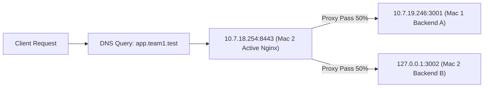
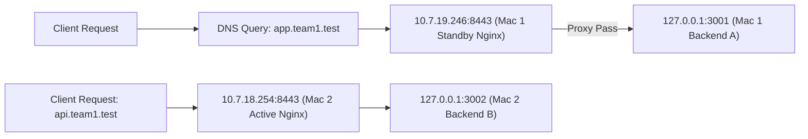

# Architecture — Private Network Service Platform (Phase 1 & Phase 2)

## 1. Infrastructure Overview

The project is deployed across **two physical Apple MacBook laptops** operating on a shared private local area network (LAN). Following the course specification for teams of 2 students, the **four logical architecture roles** are combined across the two physical machines.

### Hardware & Team Allocation

| Machine | Owner | Primary Logical Roles | Current LAN IP (`en0`) |
|---------|-------|-----------------------|------------------------|
| **Mac 1** | **Shivansh Tiwari** | Primary DNS Resolver (`dnsmasq`)<br>Standby Edge Reverse Proxy (`nginx`)<br>Backend A Application Server<br>Test & Monitoring Client | `10.7.19.246` |
| **Mac 2** | **Nav Prabhat Singh** | Backup DNS Resolver (`dnsmasq`)<br>Active Edge Reverse Proxy & Load Balancer (`nginx`)<br>Backend B Application Server<br>Test & Monitoring Client | `10.7.18.254` |

> [!NOTE]
> **DHCP Address Flexibility:**
> Network IP addresses (`10.7.19.246` and `10.7.18.254`) are assigned via DHCP on the local private Wi-Fi network. If DHCP leases change between sessions, IP parameters can be updated in configuration files or passed as environment variables to the test scripts without altering the underlying architecture.

---

## 2. Logical Roles and Network Service Map

```
                                  Shared Private LAN
                     (Wi-Fi / 10.7.0.0/16 Subnet - en0 Interfaces)
         ══════════════════════════════════════════════════════════════════
                         ║                                  ║
         ┌───────────────╨────────────────┐ ┌───────────────╨────────────────┐
         │             Mac 1              │ │             Mac 2              │
         │     Owner: Shivansh Tiwari     │ │    Owner: Nav Prabhat Singh    │
         │         (10.7.19.246)          │ │         (10.7.18.254)          │
         ├────────────────────────────────┤ ├────────────────────────────────┤
         │ [Primary DNS Resolver]         │ │ [Backup DNS Resolver]          │
         │  dnsmasq (Port 53)             │ │  dnsmasq (Port 53)             │
         │                                │ │                                │
         │ [Standby HTTPS Edge]           │ │ [Active HTTPS Edge & LB]       │
         │  nginx (Port 8443)             │ │  nginx (Port 8443)             │
         │                                │ │                                │
         │ [Backend Server A]             │ │ [Backend Server B]             │
         │  Node.js / Python (Port 3001)  │ │  Node.js / Python (Port 3002)  │
         │                                │ │                                │
         │ [Packet Filter Anchor]         │ │ [Packet Filter Anchor]         │
         │  pfctl com.apple/cnproject     │ │  pfctl com.apple/cnproject     │
         │                                │ │                                │
         │ [Test & Diagnosis Client]      │ │ [Test & Diagnosis Client]      │
         └────────────────────────────────┘ └────────────────────────────────┘
```

### Complete Network Port Map

| Component | Host | Protocol | Port | Interface Binding | Purpose |
|-----------|------|----------|------|-------------------|---------|
| **Primary DNS** | Mac 1 | UDP/TCP | `53` | `10.7.19.246`, `127.0.0.1` | Authoritative DNS resolver with `local-ttl=30` |
| **Backup DNS** | Mac 2 | UDP/TCP | `53` | `10.7.18.254`, `127.0.0.1` | Redundant DNS resolver with identical zone records |
| **Active Edge Proxy** | Mac 2 | TCP (TLS) | `8443` | `0.0.0.0` (all interfaces) | Public entry point; terminates TLS; load balances |
| **Standby Edge Proxy** | Mac 1 | TCP (TLS) | `8443` | `0.0.0.0` (all interfaces) | Warm standby edge for controlled migration (Ext E) |
| **Backend A** | Mac 1 | TCP (HTTP)| `3001`| `0.0.0.0` (LAN accessible) | Application server instance A (X-Backend: A) |
| **Backend B** | Mac 2 | TCP (HTTP)| `3002`| `0.0.0.0` (LAN accessible) | Application server instance B (X-Backend: B) |
| **TTL Caching Resolver**| Mac 1 | UDP/TCP | `5300`| `127.0.0.1` (loopback only)| Isolated client caching resolver for TTL testing |

---

## 3. Private Domain Namespace & DNS States

The architecture establishes the private RFC 2606 / RFC 6761 `.test` namespace:
- **Application Hostname:** `app.team1.test`
- **API Hostname:** `api.team1.test`

### DNS Operational States

The system operates in two distinct, controlled DNS configurations:

#### State 1: Normal Operational Baseline (Active Edge on Mac 2)

- `app.team1.test` → `10.7.18.254` (Mac 2 Active Edge)
- `api.team1.test` → `10.7.18.254` (Mac 2 Active Edge)

#### State 2: Controlled Edge Migration (Standby Edge on Mac 1)

- `app.team1.test` → `10.7.19.246` (Mac 1 Standby Edge)
- `api.team1.test` → `10.7.18.254` (Mac 2 Active Edge - unchanged)

---

## 4. End-to-End Request Journey & Protocol Stack Mapping

A complete user request traversing `https://app.team1.test:8443/api/info` maps through every layer of the TCP/IP and OSI reference models:

```
+─────────────────────────────────────────────────────────────────────────────+
| Layer 7: Application Layer                                                  |
| - DNS: UDP 53 query for app.team1.test -> receives 10.7.18.254 (TTL=30)     |
| - HTTP/1.1: GET /api/info over TLS socket                                   |
| - Headers: Host, X-Backend, Cache-Control: public, max-age=30, ETag         |
+─────────────────────────────────────────────────────────────────────────────+
                                     │
+─────────────────────────────────────────────────────────────────────────────+
| Layer 6 / 5: Presentation & Session (TLS Termination)                       |
| - TLS 1.2 / TLS 1.3 handshake terminated at Nginx on Mac 2                  |
| - X.509 Certificate verification against trusted local CA (mkcert)          |
| - ClientHello -> ServerHello -> Certificate -> Key Exchange -> Finished     |
+─────────────────────────────────────────────────────────────────────────────+
                                     │
+─────────────────────────────────────────────────────────────────────────────+
| Layer 4: Transport Layer                                                    |
| - TCP Three-Way Handshake: Client ephemeral port -> Server port 8443        |
| - Flags: SYN -> SYN-ACK -> ACK                                              |
| - Reliable stream, sequence numbers, window management                      |
+─────────────────────────────────────────────────────────────────────────────+
                                     │
+─────────────────────────────────────────────────────────────────────────────+
| Layer 3: Network (Internet) Layer                                           |
| - IPv4 routing across private Wi-Fi LAN subnet 10.7.0.0/16                  |
| - IP packet headers: Source IP 10.7.19.246 <-> Destination IP 10.7.18.254  |
+─────────────────────────────────────────────────────────────────────────────+
                                     │
+─────────────────────────────────────────────────────────────────────────────+
| Layer 2 & 1: Data Link & Physical Layer                                     |
| - IEEE 802.11 Wi-Fi frames over physical interface en0                      |
| - ARP resolution mapping IP addresses to hardware MAC addresses             |
+─────────────────────────────────────────────────────────────────────────────+
```

---

## 5. Phase 2 Resilience & Hardening Subsystems

### A. High Availability Backend Failover (Extension D)
Active nginx on Mac 2 implements passive health checking in its upstream configuration:
```nginx
upstream backend_pool {
    server 10.7.19.246:3001 max_fails=1 fail_timeout=10s;
    server 127.0.0.1:3002 max_fails=1 fail_timeout=10s;
}
```
When `Backend A` on Mac 1 is terminated or fails to respond within 2 seconds:
1. Nginx intercepts the TCP connection error or timeout.
2. `proxy_next_upstream` reroutes the pending request to `Backend B` without returning an error to the client.
3. Nginx marks `Backend A` down for 10 seconds (`fail_timeout`).
4. Subsequent client requests are directed 100% to `Backend B`.
5. Upon recovery of `Backend A`, Nginx automatically re-admits it to the round-robin rotation.

### B. Service Isolation via macOS Packet Filter (Extension C)
To prevent clients or unauthorized LAN nodes from bypassing the reverse proxy and directly querying internal backend application servers:
- **Mac 1 PF Policy:** Drops all inbound packets to TCP port 3001 unless the source IP matches `10.7.18.254` (Mac 2 Edge) or loopback `127.0.0.1`.
- **Mac 2 PF Policy:** Drops all inbound packets to TCP port 3002 on external interface `en0`. Backend B binds locally, accessible only through loopback (`lo0`) by Mac 2 nginx.

### C. DNS Redundancy & Failover (Extension A & B)
- Both Mac 1 and Mac 2 run synchronized `dnsmasq` instances on port 53.
- Client machines configure both nameservers: `nameserver 10.7.19.246` and `nameserver 10.7.18.254`.
- If the primary DNS daemon stops, the client stub resolver automatically fails over to the backup resolver within standard timeout thresholds.
- Authoritative records enforce `local-ttl=30`, enabling controlled cutovers and predictable cache expiry.
